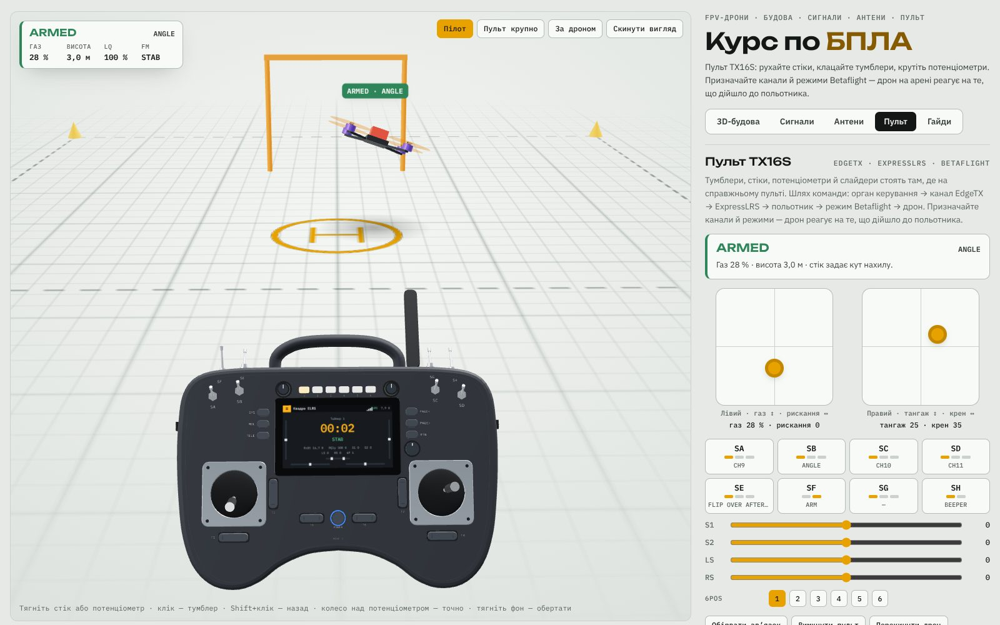
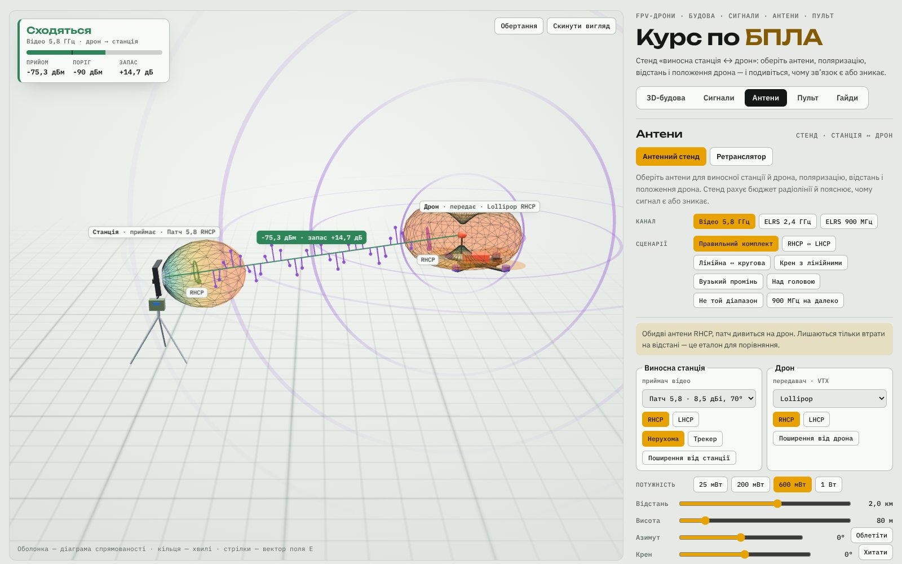
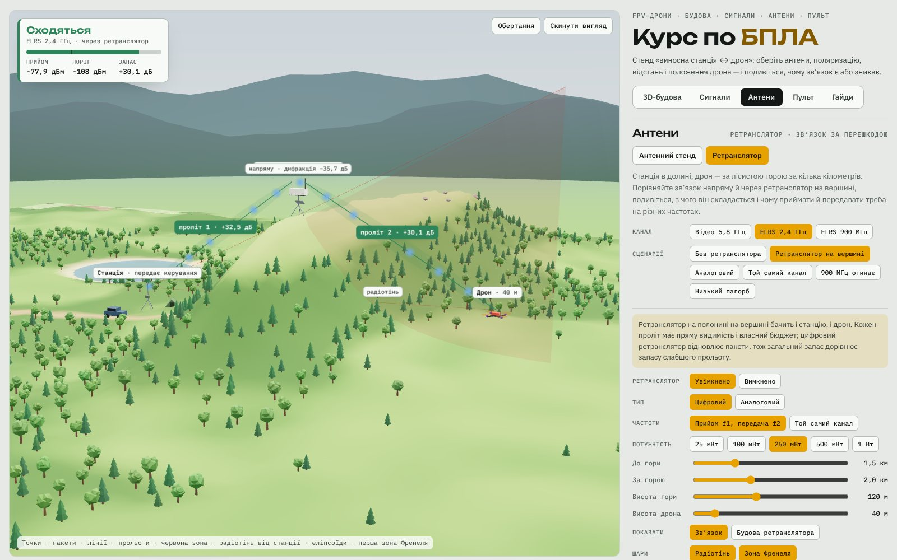

# Курс по БПЛА

Інтерактивний навчальний курс з будови FPV-дронів і радіозв'язку в браузері. Шість розділів: 3D-будова з конфігуратором для п'яти платформ, покрокові ланцюжки сигналів усередині дрона, антенний стенд і ретранслятор з розрахунком радіолінії, 3D-пульт TX16S з симулятором дрона, FPV-окуляри (аналогові й цифрові) та покрокові гайди з налаштування Betaflight, EdgeTX і ExpressLRS.

Проєкт навчальний і цивільний: усе, що тут показано, — загальновідомі принципи будови й налаштування FPV-техніки та радіозв'язку.



## Розділи

### 3D-будова
- **П'ять платформ:** 5″ фрістайл, 7″ лонг-рейндж, 10″ важкий, гексакоптер 7″ (Hex X, 6 моторів) і tiny whoop 75 мм (клас Air75 / Meteor75, AIO-плата).
- **12 вузлів** на кожній платформі: рама, мотори, пропелери, ESC, польотник, приймач, VTX і антена, камера, акумулятор, силовий роз'єм, GPS. Усе змодельовано процедурно в коді, без зовнішніх 3D-файлів.
- **Взаємодія:** наведення — підказка з виноскою, клік — фокус і прозорість решти моделі, подвійний клік (на телефоні подвійний тап) — бічна панель з визначенням, видами, параметрами й заміною компонента.
- **Анімації:** мотори (Props In / Props Out, тест 1→4 або 1→6 за нумерацією Betaflight), польотник (BOOT, DFU, прошивка), приймач ExpressLRS (немає зв'язку, біндинг, зв'язок, Wi-Fi).
- **Конфігуратор:** варіанти під кожну платформу, зокрема тепловізори 256×192 і 640×512 та Li-ion 6S1P, 6S2P, 6S3P, 8S2P, 10S2P. Оцінка злітної маси, тяги/ваги, пікового струму, часу польоту й попередження про несумісні комбінації (KV проти напруги, ESC, конденсатор, струм Li-ion).
- **Камера:** види камер (денна, нічна, тепловізійна, цифрова HD), шлях відеопотоку в аналоговій і цифровій системах та таблиця відмінностей.

### Сигнали
Один ланцюжок за раз, крок за кроком: **керування** (пульт → приймач → польотник → ESC → мотори), **живлення**, **відео** (аналоговий і цифровий тракти) і **телеметрія**. На кожному кроці видно, звідки й куди йде сигнал і яким протоколом (CRSF, DShot, CVBS, MIPI CSI, MSP DisplayPort…). Ланцюжки перебудовуються під обрані платформу й компоненти: окремі ESC на гексі, AIO на whoop, аналог чи цифра.

### Антени
Стенд «виносна станція ↔ дрон» для відео 5,8 ГГц, ELRS 2,4 ГГц і ELRS 868/915 МГц.
- **Каталог антен:** Lollipop, Pagoda, Stubby, диполі, патчі, хелікал, Moxon, Yagi, Immortal-T, керамічна.
- **3D-діаграми спрямованості** кожної антени, хвилі від обраного джерела, вектор електричного поля вздовж лінії зв'язку (кругова RHCP/LHCP або лінійна поляризація), промінь відбиття від землі.
- **Керування:** поляризація кожної антени, наведення станції (нерухоме або трекер), потужність, частота пакетів ELRS, відстань, висота, азимут і крен дрона, анімації «Облетіти» та «Хитати».
- **Бюджет радіолінії:** потужність, підсилення антен під поточним кутом, втрати у вільному просторі, поляризаційні втрати, неузгодження діапазону, радіогоризонт, рівень на приймачі, запас до порогу чутливості й дальність із запасом 10 дБ. Вердикт «Сходяться / На межі / Не сходяться» з поясненням причин і порадою, що змінити.
- **Сценарії:** правильний комплект, RHCP ↔ LHCP, лінійна ↔ кругова, крен з лінійними антенами, вузький промінь хелікала, політ над головою, антена не того діапазону, 900 МГц на далеко.



#### Ретранслятор
Підрозділ «Ретранслятор»: станція в долині, дрон за лісистою горою, на полонині на вершині — ретранслятор. Місцевість процедурна: гора з межею лісу й гребенем, що йде вдалину, передгір’я, мішаний ліс, озеро, дорога й поля, небо з туманом і далекими хребтами; у темній темі — сутінки. Висота гори з повзунка перебудовує рельєф і ліс. Шари «Радіотінь» і «Зона Френеля» вмикаються окремо.


- **Пряма лінія й радіотінь:** дифракція на вершині за моделлю одиночної «ножової» перешкоди (ITU-R P.526), видима зона радіотіні й перша зона Френеля кожного прольоту.
- **Через ретранслятор:** окремий бюджет для кожного прольоту; цифровий ретранслятор (декодує пакети — запас дорівнює слабшому прольоту, додається затримка) і аналоговий (шуми прольотів додаються).
- **Частоти:** прийом на f1, передача на f2; сценарій «той самий канал» показує самоглушіння без розв'язки.
- **Будова:** анімація розбирання — антени прийому й передачі, фільтри, приймач, обробка, передавач, живлення — і проходження сигналу крізь вузли.
- **Сценарії:** без ретранслятора, ретранслятор на вершині, аналоговий, той самий канал, 900 МГц огинає, низький пагорб.

### Пульт
3D-репліка TX16S (Mode 2) з органами керування на своїх місцях: тумблери SA–SD спереду, SE–SH зверху (SF — 2 положення, SH — без фіксації), потенціометри S1 і S2, шість кнопок, слайдери LS і RS на боках, стіки на холах, шість тримів, кнопки меню, колесо, живлення й складана антена.
- **Взаємодія:** стіки тягнуться мишею чи пальцем (газ без пружини), тумблери клацаються, потенціометри й слайдери крутяться й тягнуться, трими натискаються; на панелі — дубль стіків і тумблерів, на клавіатурі — W/S, A/D, стрілки, пробіл, 1/2/3, E, H. Екран пульта показує головний екран, телеметрію, монітор каналів, мікшер і налаштування.
- **Канали EdgeTX:** CH1–CH4 — стіки в порядку AETR, CH5–CH12 — будь-який тумблер, потенціометр, слайдер чи 6POS, реверс каналу. 100 % = 512 одиниць, 988–2012 мкс.
- **ExpressLRS і Betaflight:** AUX1 (CH5) приходить одним бітом; карта каналів AETR1234 чи TAER1234; режими ARM, ANGLE, HORIZON, BEEPER, FLIP OVER AFTER CRASH і FAILSAFE з AUX-каналом і діапазоном; прапорці заборони армування (THROTTLE, ANGLE, RXLOSS, FAILSAFE, ARMSWITCH, BADRX); failsafe зі стадіями 1 і 2 (Drop або Land); телеметрія FM, RxBt, RQly.
- **Симулятор дрона:** ANGLE, HORIZON і Acro з рейтами Actual, зліт, посадка й удар об землю, turtle після перевертання, біпер (зі звуком за бажанням), втрата зв'язку й вимкнення пульта, стартові перевірки EdgeTX.
- **Типові помилки:** тример газу, неправильна карта каналів, реверс тангажу, ARM на 3-позиційному тумблері, ARM до появи зв'язку, втрата зв'язку в польоті.

### Окуляри
Аналогові окуляри на прикладі Skyzone SKY04X Pro і цифрові на прикладі DJI Goggles 3. 3D-моделі узагальнені (без логотипів і копіювання дизайну); органи керування працюють так, як описано в посібниках виробників.
- **Аналог:** два колеса, дві кнопки й кнопка живлення/вентилятора. Праве колесо — канал → бенд → режим MIX1–3 / DIV, утримання — автопошук по 48 каналах; ліве колесо — гучність, режими (RF, AV IN, HDMI IN, Playback), утримання — Drone Finder; ліва кнопка — запис DVR; права — системне меню (тип батареї, яскравість, формат кадру, сон екрана, вентилятор, режим DVR, форматування SD).
- **Цифра:** кнопка 5D (меню, панель камери, швидке меню), «Назад», живлення (заряд; натиснути й утримати — увімк/вимк; утримати до сигналу — прив'язка), подвійне натискання правого боку — Real View. Меню «Статус», «Альбом», «Передавання» (канал авто/ручний, смуга 20/40/60 МГц, Race Mode), «Налаштування»; прив'язка з кнопкою на модулі.
- **Екран пілота:** картинка з дрона з OSD польотника й рядком окулярів. Аналог на слабкому сигналі шумить, втрачає колір і синхронізацію, на чужому каналі — сніг; цифра показує бітрейт і затримку, на межі — квадрати й підвисання, далі зависає.
- **Радіолінія:** потужність VTX і pit mode, бенд і канал, поляризація антен, відстань, перешкоди; для цифри — смуга, Race Mode, стан антен, перегрів модуля.
- **Типові проблеми:** не той канал, різна поляризація, далеко за деревами, pit mode, немає SD-картки; не прив'язані, слабкий сигнал, складені антени, немає OSD (MSP DisplayPort), перегрів модуля.
- **Як користуватись:** по 10 кроків для кожного типу — підготовка, зв'язок з дроном, екран і запис; кожен крок підсвічує потрібні органи керування й може виконати дію на симуляторі.

### Гайди
Три покрокові гайди без прив'язки до конкретної плати чи цілі прошивки: **Betaflight** (14 кроків — від резервної копії й прошивки до режимів, моторів, failsafe, OSD і першого польоту), **пульт на EdgeTX** (11 кроків — калібрування, оновлення, модель, внутрішній модуль ELRS, входи, мікшер, виходи, трими, телеметрія) і **ExpressLRS** (9 кроків — що має збігатися, прошивка, bind phrase, біндинг, підключення до польотника, Lua-скрипт, перевірка лінку, WiFi, типові проблеми). На кожному кроці 3D-сцена показує вузол дрона або орган пульта; посилання ведуть до відповідних анімацій і сценаріїв. Позначки «готово» зберігаються в браузері.

Розділи відкриваються за посиланням з хешем: `#signals`, `#antennas`, `#radio`, `#goggles`, `#guides`.

## Запуск

Потрібен Node.js 20.19 або новіший.

```bash
npm install
npm run dev        # дев-сервер з гарячим перезавантаженням: http://localhost:5173
npm run build      # продакшн-збірка в dist/
npm run preview    # перегляд зібраного dist/
npm run build:single   # один самодостатній HTML у dist-single/ (для артефакту чи офлайн-показу)
```

Three.js встановлюється з npm і входить у збірку; з інтернету підтягуються лише шрифти. Сторінку треба відкривати через сервер (dev, preview чи GitHub Pages): ES-модулі не працюють з `file://`, окрім збірки `build:single`. Без WebGL сторінка показує текстову частину: описи, конфігуратор, кроки сигналів і розрахунок антен.

**GitHub Pages:** Settings → Pages → Build and deployment → Source: **GitHub Actions**. Далі кожен пуш у `main` збирає й публікує сайт (`.github/workflows/deploy.yml`). Для приватного репозиторію Pages доступні лише на платних планах GitHub.

## Структура

```
index.html                  розмітка сторінки, точка входу Vite
vite.config.js              збірка: base './', режим single
src/
  main.js                   вхід: стилі, init(), хук window.__fpv для тестів
  styles/main.css           стилі й токени світлої та темної теми
  data/
    content.js              контент вузлів: описи, параметри, види, шлях відеопотоку
    options.js              платформи, варіанти конфігуратора, розрахунок характеристик
  engine/
    core.js                 рендерер, граф сцени, текстури, геометричні хелпери, розкладка платформ
    anim.js                 стан, оверлеї, підсвітка, камера, мітки, вибір, тур
    demos.js                анімації вузлів, режими, головний цикл, вказівник
  models/
    builders.js             3D-моделі вузлів для 5″, 7″, 10″ і гекси
    whoop.js                3D-моделі tiny whoop
  sections/
    signals.js              розділ «Сигнали»
    antlab.js               розділ «Антени»: каталог, фізична модель, 3D-стенд, панель
    relay.js                «Антени» → «Ретранслятор»: дифракція, прольоти, процедурна місцевість, будова
    radio.js                розділ «Пульт»: 3D-модель TX16S, канали, режими Betaflight, симулятор дрона
    goggles.js              розділ «Окуляри»: моделі окулярів, екран пілота, меню, прив'язка, радіолінія, кроки
    guides.js               розділ «Гайди»: Betaflight, EdgeTX, ExpressLRS
  ui/
    ui.js                   перемикачі, специфікація, конфігуратор, бічна панель, події, init()
tests/smoke.js              smoke-тест на Playwright (збирає dist/ і відкриває через локальний сервер)
.github/workflows/          CI (збірка + тест) і деплой на Pages
docs/                       знімки для README: radio.jpg — пульт, preview.jpg — антенний стенд, relay.jpg — ретранслятор
```

Модулі звичайні ES-модулі з явними `import`/`export`. Правила, що тримають граф залежностей простим:
- `data/` не залежить від решти; `engine/core.js` — лише від `data/` і `three`, тому його можна імпортувати звідусіль, навіть на верхньому рівні модуля.
- Розділи (`sections/`) і `ui/` посилаються одне на одного лише всередині функцій; код верхнього рівня модуля не викликає функцій з інших модулів, окрім `core.js`. Уся ініціалізація — з `init()` у `ui/ui.js`, який викликає `main.js`.
- Спільний змінний стан живе в модулі-власнику (`S` в `anim.js`, `ctl` у `demos.js`, `scene`/`camera` у `core.js`); інші модулі його читають, а змінюють через функції власника (`initSceneGraph()`, `setOk3d()`).

## Модель антенного стенду

- Втрати у вільному просторі: `FSPL = 20·lg(d, км) + 20·lg(f, МГц) + 32,44`; відстань — похила, з урахуванням висоти.
- Діаграми: напівхвильовий диполь — точна формула `cos(π/2·cosθ)/sinθ`; всеспрямовані кругові — `sinⁿθ` з обмеженням мертвої зони; спрямовані — `G − min(12·(θ/θ₃)², F/B)`.
- Поляризація: однаковий напрям обертання — 0 дБ; RHCP ↔ LHCP — 20 дБ (на практиці 15–25); кругова ↔ лінійна — 3 дБ; лінійна ↔ лінійна — `−20·lg|cos ψ|` до 25 дБ.
- Чутливість ELRS за частотою пакетів — з таблиці ExpressLRS; поріг аналогового відеоприймача — −90 дБм.
- Радіогоризонт: `4,12·(√h₁ + √h₂)` км для щогли 5 м і висоти дрона; за ним — оцінка −30 дБ.
- Неузгодження діапазону — оцінка 15 дБ на антену.

Геометрія в розрахунку справжня (кілометри й метри), а 3D-сцена стиснута лише для показу.

## Модель ретранслятора

- Дифракція на вершині: `v = h·√(2(d₁+d₂)/(λ·d₁·d₂))`, `J(v) = 6,9 + 20·lg(√((v−0,1)²+1) + v − 0,1)` для `v > −0,78` (ITU-R P.526, одиночна перешкода).
- Перша зона Френеля посередині прольоту: `r = ½·√(λ·d)`.
- Цифровий ретранслятор: запас = мінімум запасів прольотів. Аналоговий: `−10·lg(10^(−m₁/10) + 10^(−m₂/10))`.
- Той самий канал без розв'язки: власний передавач глушить приймач, лінія не працює.
- Рельєф у розрахунку — одна вершина; ліс, передгір’я й озеро в сцені — для наочності, у бюджет не входять.

## Модель окулярів

- Аналог: рівень на вході = потужність VTX + підсилення антен − втрати у вільному просторі (5,8 ГГц) − перешкоди (дерева ≈12 дБ, пагорб ≈28 дБ) − поляризація (20 дБ) − розстроювання каналу (від ≈8 дБ, далі ≈1,3 дБ/МГц). Чиста картинка вище ≈ −78 дБм, сніг нижче ≈ −98 дБм. Частоти бендів A, B, E, F, R, L — з таблиці посібника окулярів.
- Цифра: поріг приймача залежить від смуги (20 / 40 / 60 МГц — від ≈ −95 до −89 дБм); бітрейт до 25 / 40 / 60 Мбіт/с падає зі зменшенням запасу; затримка ≈24 мс при 100 кадрах/с, ≈40 мс при 60, ≈20 мс у Race Mode й росте на слабкому сигналі. Нижче порогу картинка зависає.
- Значення — навчальні оцінки, а не паспортні дані окулярів чи модуля.

## Модель пульта й дрона

- Канал EdgeTX: `1500 + 512·v` мкс, `v` — сума джерела й тримера з обмеженням ±100 %.
- ExpressLRS: AUX1 передається одним бітом (верх — лише вище центру).
- Betaflight: діапазон режиму активний при `start ≤ значення < end`; армування блокують THROTTLE (газ > 1050 мкс), ANGLE (нахил > 25°, крім turtle), RXLOSS, FAILSAFE, ARMSWITCH, BADRX.
- Failsafe: ≈0,3 с без пакетів — стадія 1 (стіки по центру, газ на мінімумі, AUX тримаються), через failsafe_delay — стадія 2 (Drop або Land).
- Дрон: рейти Actual (центр 70°/с, максимум 670°/с, експо 0,54), у ANGLE кут до 55°, тяга 3,2g, лінійний і квадратичний опір. Розміри дрона й арени умовні.

## Технології

- **Three.js 0.128 (WebGL, з npm):** PBR-матеріали, карта середовища з `PMREMGenerator`, процедурна геометрія (`Shape`, `ExtrudeGeometry`, `TubeGeometry`), `Raycaster`, `ShaderMaterial` для хвиль з прозорістю за діаграмою.
- **JavaScript (ES2020, ES-модулі)** без фреймворку, збірка — **Vite**. Власний orbit-контролер на Pointer Events.
- **CSS:** custom properties для тем, Grid, `position: sticky`, `dvh`, safe-area insets, `color-mix()`.
- **Canvas 2D** для текстур, **SVG** для схеми напрямів обертання.

## Як додати варіант компонента

1. Додайте об'єкт у відповідний масив `OPTS` у `src/data/options.js`, указавши платформи в полі `pl`.
2. Якщо варіант має виглядати інакше, змініть builder вузла в `src/models/builders.js` або `src/models/whoop.js`.
3. Якщо заміна впливає на інші вузли, допишіть залежність у мапу `DEPENDS` у `src/models/builders.js`.

Нова антена для стенду — об'єкт у `ANT` у `src/sections/antlab.js` (діапазон, тип діаграми, поляризація, підсилення, ширина променя) і, за потреби, модель в `antModel()`.

## Тести

```bash
npm install
npx playwright install chromium
npm test
```

Тест проходить усі платформи, режими, анімації, варіанти конфігуратора (на десктопі), ланцюжки сигналів, сценарії антенного стенду й ретранслятора з перемикачами шарів, тумблери й сценарії пульта з перевіркою армування та всі кроки трьох гайдів на десктопній і мобільній ширині, відкриває бічну панель камери й перевіряє помилки в консолі та горизонтальне прокручування. Тест спершу збирає `dist/` і відкриває його через вбудований локальний сервер. Скриншоти зберігаються в `tests/shots/`. На GitHub той самий тест запускає CI.

## Обмеження

- Маса, тяга, струм і час польоту — інженерні оцінки за спрощеною моделлю для типових компонентів свого класу, а не паспортні дані конкретних моделей.
- Антенний стенд рахує вільний простір: без рельєфу, перешкод, зони Френеля й завмирань. Реальна дальність у рази менша, але співвідношення між варіантами ті самі. Підсилення антен — типові значення для свого класу.
- Ретранслятор рахує одну «ножову» вершину без відбиттів, втрат у лісі й кривизни Землі; пейзаж у сцені процедурний і стиснутий по горизонталі.
- Анімація світлодіода приймача відтворює логіку ExpressLRS; у TBS Crossfire індикація інша, тому Wi-Fi-режим для нього вимкнено.
- Симулятор дрона в розділі «Пульт» спрощений: ідеальний регулятор, оцінна тяга, без вітру й інерції моторів. Розташування тумблерів, потенціометрів, слайдерів і тримів відповідає TX16S Mark II; розкладку кнопок меню біля екрана відтворено наближено.
- Гайди описують загальний порядок; назви пунктів меню можуть відрізнятися між версіями Betaflight, EdgeTX і ExpressLRS.
- Three.js зафіксовано на 0.128: між нею й актуальними версіями змінилися API освітлення, колірних просторів і частини геометрій, тож оновлення — окремий крок з перевіркою всіх сцен.

## Джерела

- [ExpressLRS — Signal Health (чутливість за частотою пакетів)](https://expresslrs.org/info/signal-health/)
- [ExpressLRS — LED Status](https://expresslrs.org/quick-start/led-status)
- [ExpressLRS — WebUI](https://expresslrs.org/quick-start/webui/)
- [Betaflight — Position Hold 2025.12](https://betaflight.com/docs/wiki/guides/current/Position-Hold-2025-12)
- [Betaflight — Motors tab](https://betaflight.com/docs/wiki/app/motors-tab)
- [EdgeTX — User Interface (кнопки SYS, MDL, TELE, PAGE, RTN)](https://manual.edgetx.org/color-radios/user-interface)
- [EdgeTX — Access DFU and Bootloader Mode](https://manual.edgetx.org/edgetx-how-to/access-dfu-and-bootloader-mode)
- [ITU-R P.526 — Propagation by diffraction](https://www.itu.int/rec/R-REC-P.526/en)
