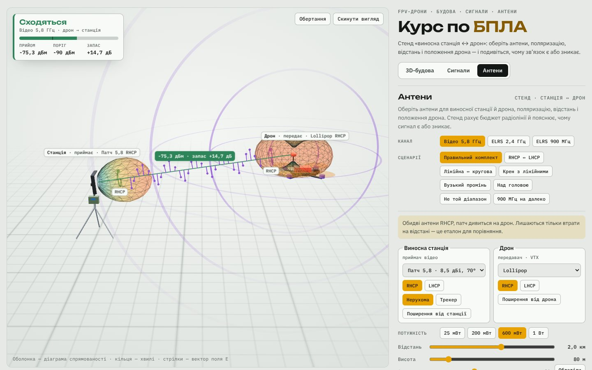

# Курс по БПЛА

Інтерактивний навчальний курс з будови FPV-дронів у браузері. Три розділи: 3D-будова з конфігуратором для п'яти платформ, покрокові ланцюжки сигналів усередині дрона та антенний стенд «виносна станція ↔ дрон» з розрахунком радіолінії.



## Розділи

### 3D-будова
- **П'ять платформ:** 5″ фрістайл, 7″ лонг-рейндж, 10″ важкий, гексакоптер 7″ (Hex X, 6 моторів) і tiny whoop 75 мм (клас Air75 / Meteor75, AIO-плата).
- **12 вузлів** на кожній платформі: рама, мотори, пропелери, ESC, польотник, приймач, VTX і антена, камера, акумулятор, силовий роз'єм, GPS. Усе змодельовано процедурно в коді, без зовнішніх 3D-файлів.
- **Взаємодія:** наведення — підказка з виноскою, клік — фокус і прозорість решти моделі, подвійний клік (на телефоні подвійний тап) — бічна панель з визначенням, видами, параметрами й заміною компонента.
- **Анімації:** мотори (Props In / Props Out, тест 1→4 або 1→6 за нумерацією Betaflight), польотник (BOOT, DFU, прошивка), приймач ExpressLRS (немає зв'язку, біндинг, зв'язок, Wi-Fi).
- **Конфігуратор:** варіанти під кожну платформу, зокрема тепловізори 256×192 і 640×512 та Li-ion 6S1P, 6S2P, 6S3P, 8S2P, 10S2P. Оцінка злітної маси, тяги/ваги, пікового струму, часу польоту й попередження про несумісні комбінації (KV проти напруги, ESC, конденсатор, струм Li-ion).
- **Камера:** види камер (денна, нічна, тепловізійна, цифрова HD), шлях відеопотоку в аналоговій і цифровій системах та таблиця відмінностей.

### Сигнали
Один ланцюжок за раз, крок за кроком: **керування** (пульт → приймач → польотник → ESC → мотори), **живлення**, **відео** (аналоговий і цифровий тракти) і **телеметрія**. На кожному кроці видно, звідки й куди йде сигнал і яким протоколом (CRSF, DShot, CVBS, MIPI CSI, MSP DisplayPort…). Ланцюжки перебудовуються під обрані платформу й компоненти: окремі ESC на гексі, AIO на whoop, аналог чи цифра.

### Антени
Стенд «виносна станція ↔ дрон» для відео 5,8 ГГц, ELRS 2,4 ГГц і ELRS 868/915 МГц.
- **Каталог антен:** Lollipop, Pagoda, Stubby, диполі, патчі, хелікал, Moxon, Yagi, Immortal-T, керамічна.
- **3D-діаграми спрямованості** кожної антени, хвилі від обраного джерела, вектор електричного поля вздовж лінії зв'язку (кругова RHCP/LHCP або лінійна поляризація), промінь відбиття від землі.
- **Керування:** поляризація кожної антени, наведення станції (нерухоме або трекер), потужність, частота пакетів ELRS, відстань, висота, азимут і крен дрона, анімації «Облетіти» та «Хитати».
- **Бюджет радіолінії:** потужність, підсилення антен під поточним кутом, втрати у вільному просторі, поляризаційні втрати, неузгодження діапазону, радіогоризонт, рівень на приймачі, запас до порогу чутливості й дальність із запасом 10 дБ. Вердикт «Сходяться / На межі / Не сходяться» з поясненням причин і порадою, що змінити.
- **Сценарії:** правильний комплект, RHCP ↔ LHCP, лінійна ↔ кругова, крен з лінійними антенами, вузький промінь хелікала, політ над головою, антена не того діапазону, 900 МГц на далеко.

Розділи відкриваються за посиланням: `index.html#signals`, `index.html#antennas`.

## Запуск

Збирати нічого не треба: відкрийте `index.html` у браузері. Three.js і шрифти завантажуються з CDN, тому потрібен інтернет. Без WebGL сторінка показує текстову частину: описи, конфігуратор, кроки сигналів і розрахунок антен.

Локальний сервер (необов'язково):

```bash
npm start
```

GitHub Pages: Settings → Pages → Deploy from a branch → `main`, папка `/ (root)`. Для приватного репозиторію Pages доступні лише на платних планах GitHub.

## Структура

```
index.html          розмітка сторінки
css/styles.css      стилі й токени світлої та темної теми
js/content.js       контент вузлів: описи, параметри, види, шлях відеопотоку
js/options.js       платформи, варіанти конфігуратора, розрахунок характеристик
js/core.js          рендерер, текстури, геометричні хелпери, розкладка платформ
js/builders.js      3D-моделі вузлів для 5″, 7″, 10″ і гекси
js/whoop.js         3D-моделі tiny whoop
js/anim.js          стан, оверлеї, підсвітка, камера, мітки, вибір, тур
js/demos.js         анімації вузлів, режими, головний цикл, вказівник
js/signals.js       розділ «Сигнали»
js/antlab.js        розділ «Антени»: каталог, фізична модель, 3D-стенд, панель
js/ui.js            перемикачі, специфікація, конфігуратор, бічна панель, події
tests/smoke.js      smoke-тест на Playwright
docs/preview.jpg    знімок для README
```

Скрипти класичні (не ES-модулі) і ділять глобальну область видимості, тому сторінка відкривається навіть з `file://`. Порядок підключення в `index.html` важливий: `content → options → core → builders → whoop → anim → demos → signals → antlab → ui`.

## Модель антенного стенду

- Втрати у вільному просторі: `FSPL = 20·lg(d, км) + 20·lg(f, МГц) + 32,44`; відстань — похила, з урахуванням висоти.
- Діаграми: напівхвильовий диполь — точна формула `cos(π/2·cosθ)/sinθ`; всеспрямовані кругові — `sinⁿθ` з обмеженням мертвої зони; спрямовані — `G − min(12·(θ/θ₃)², F/B)`.
- Поляризація: однаковий напрям обертання — 0 дБ; RHCP ↔ LHCP — 20 дБ (на практиці 15–25); кругова ↔ лінійна — 3 дБ; лінійна ↔ лінійна — `−20·lg|cos ψ|` до 25 дБ.
- Чутливість ELRS за частотою пакетів — з таблиці ExpressLRS; поріг аналогового відеоприймача — −90 дБм.
- Радіогоризонт: `4,12·(√h₁ + √h₂)` км для щогли 5 м і висоти дрона; за ним — оцінка −30 дБ.
- Неузгодження діапазону — оцінка 15 дБ на антену.

Геометрія в розрахунку справжня (кілометри й метри), а 3D-сцена стиснута лише для показу.

## Технології

- **Three.js r128 (WebGL):** PBR-матеріали, карта середовища з `PMREMGenerator`, процедурна геометрія (`Shape`, `ExtrudeGeometry`, `TubeGeometry`), `Raycaster`, `ShaderMaterial` для хвиль з прозорістю за діаграмою.
- **JavaScript (ES2020)** без фреймворку й без збірки. Власний orbit-контролер на Pointer Events.
- **CSS:** custom properties для тем, Grid, `position: sticky`, `dvh`, safe-area insets, `color-mix()`.
- **Canvas 2D** для текстур, **SVG** для схеми напрямів обертання.

## Як додати варіант компонента

1. Додайте об'єкт у відповідний масив `OPTS` у `js/options.js`, указавши платформи в полі `pl`.
2. Якщо варіант має виглядати інакше, змініть builder вузла в `js/builders.js` або `js/whoop.js`.
3. Якщо заміна впливає на інші вузли, допишіть залежність у мапу `DEPENDS` у `js/builders.js`.

Нова антена для стенду — об'єкт у `ANT` у `js/antlab.js` (діапазон, тип діаграми, поляризація, підсилення, ширина променя) і, за потреби, модель в `antModel()`.

## Тести

```bash
npm install
npx playwright install chromium
npm test
```

Тест проходить усі платформи, режими, анімації, варіанти конфігуратора (на десктопі), ланцюжки сигналів і сценарії антенного стенду на десктопній і мобільній ширині, відкриває бічну панель камери й перевіряє помилки в консолі та горизонтальне прокручування. Скриншоти зберігаються в `tests/shots/`. `three@0.128.0` у devDependencies потрібен, щоб тест не залежав від CDN.

## Обмеження

- Маса, тяга, струм і час польоту — інженерні оцінки за спрощеною моделлю для типових компонентів свого класу, а не паспортні дані конкретних моделей.
- Антенний стенд рахує вільний простір: без рельєфу, перешкод, зони Френеля й завмирань. Реальна дальність у рази менша, але співвідношення між варіантами ті самі. Підсилення антен — типові значення для свого класу.
- Анімація світлодіода приймача відтворює логіку ExpressLRS; у TBS Crossfire індикація інша, тому Wi-Fi-режим для нього вимкнено.
- Three.js r128 підключено як UMD-збірку з cdnjs. Новіші версії поширюються лише як ES-модулі; для подальшого розвитку варто перейти на них разом із бандлером (наприклад, Vite).

## Джерела

- [ExpressLRS — Signal Health (чутливість за частотою пакетів)](https://expresslrs.org/info/signal-health/)
- [ExpressLRS — LED Status](https://expresslrs.org/quick-start/led-status)
- [ExpressLRS — WebUI](https://expresslrs.org/quick-start/webui/)
- [Betaflight — Position Hold 2025.12](https://betaflight.com/docs/wiki/guides/current/Position-Hold-2025-12)
